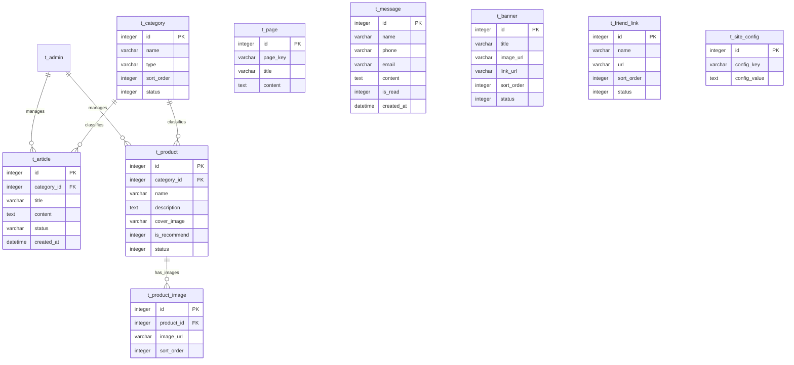

# 中小企业门户网站数据库设计

> 创建时间：2026-09-30
> 状态：待确认
> 关联流程：fullstack-dev-flow stage-2
> 关联需求：docs/需求规格.md

---

## 一、设计原则

- 字符集统一用 utf8mb4（支持 emoji）
- 主键统一命名 `id`，integer 自增（SQLite 环境 bigint 兼容）
- 时间字段统一 `created_at` / `updated_at`
- 软删除用 `deleted`（0=未删，1=已删），不用物理删除
- 表名前缀 `t_` 业务表，`sys_` 系统表
- 默认数据库 SQLite（零配置启动），可平滑切换 MySQL（建表 SQL 兼容两种语法）

---

## 二、ER 图

---

## 三、表清单

### 3.1 t_admin（管理员表）

**说明**：后台管理系统操作人员
**对应核心实体**：管理员

| 字段 | 类型 | 约束 | 默认 | 注释 |
|------|------|------|------|------|
| id | integer | PK, auto_increment | - | 主键 |
| username | varchar(50) | not null, unique | - | 用户名 |
| password_hash | varchar(100) | not null | - | 密码哈希(bcrypt) |
| nickname | varchar(50) | null | null | 昵称 |
| avatar | varchar(255) | null | null | 头像URL |
| status | tinyint | not null | 1 | 状态:0=禁用,1=启用 |
| created_at | datetime | not null | CURRENT_TIMESTAMP | 创建时间 |
| updated_at | datetime | not null | CURRENT_TIMESTAMP | 更新时间 |
| deleted | tinyint | not null | 0 | 软删除:0=未删,1=已删 |

**索引**：
- idx_username (username) — 登录查询

### 3.2 t_category（栏目分类表）

**说明**：新闻和产品的栏目分类
**对应核心实体**：栏目分类

| 字段 | 类型 | 约束 | 默认 | 注释 |
|------|------|------|------|------|
| id | integer | PK, auto_increment | - | 主键 |
| name | varchar(100) | not null | - | 分类名称 |
| type | varchar(20) | not null | - | 类型:article=新闻,product=产品 |
| sort_order | integer | not null | 0 | 排序值(越小越前) |
| status | tinyint | not null | 1 | 状态:0=禁用,1=启用 |
| created_at | datetime | not null | CURRENT_TIMESTAMP | 创建时间 |
| updated_at | datetime | not null | CURRENT_TIMESTAMP | 更新时间 |
| deleted | tinyint | not null | 0 | 软删除:0=未删,1=已删 |

**索引**：
- idx_type (type) — 按类型筛选
- idx_sort (sort_order) — 排序查询

### 3.3 t_article（新闻文章表）

**说明**：企业动态、行业资讯、通知公告等内容
**对应核心实体**：新闻文章

| 字段 | 类型 | 约束 | 默认 | 注释 |
|------|------|------|------|------|
| id | integer | PK, auto_increment | - | 主键 |
| category_id | integer | not null | - | 栏目ID,FK->t_category.id |
| title | varchar(200) | not null | - | 标题 |
| summary | varchar(500) | null | null | 摘要 |
| content | text | not null | - | 正文(富文本HTML) |
| cover_image | varchar(255) | null | null | 封面图URL |
| source | varchar(100) | null | null | 来源 |
| view_count | integer | not null | 0 | 浏览量 |
| status | varchar(20) | not null | 'draft' | 状态:draft=草稿,published=已发布 |
| published_at | datetime | null | null | 发布时间 |
| created_at | datetime | not null | CURRENT_TIMESTAMP | 创建时间 |
| updated_at | datetime | not null | CURRENT_TIMESTAMP | 更新时间 |
| deleted | tinyint | not null | 0 | 软删除:0=未删,1=已删 |

**索引**：
- idx_category (category_id) — 按栏目筛选
- idx_status_published (status, published_at) — 前台取已发布新闻按时间排序
- idx_created (created_at) — 按创建时间排序

### 3.4 t_product（产品表）

**说明**：企业产品/服务展示
**对应核心实体**：产品展示

| 字段 | 类型 | 约束 | 默认 | 注释 |
|------|------|------|------|------|
| id | integer | PK, auto_increment | - | 主键 |
| category_id | integer | not null | - | 分类ID,FK->t_category.id |
| name | varchar(200) | not null | - | 产品名称 |
| short_desc | varchar(500) | null | null | 简短描述 |
| description | text | not null | - | 详细介绍(富文本HTML) |
| cover_image | varchar(255) | null | null | 主图URL |
| params | text | null | null | 产品参数(JSON格式,键值对数组) |
| is_recommend | tinyint | not null | 0 | 是否推荐:0=否,1=是 |
| sort_order | integer | not null | 0 | 排序值 |
| status | tinyint | not null | 1 | 状态:0=下架,1=上架 |
| created_at | datetime | not null | CURRENT_TIMESTAMP | 创建时间 |
| updated_at | datetime | not null | CURRENT_TIMESTAMP | 更新时间 |
| deleted | tinyint | not null | 0 | 软删除:0=未删,1=已删 |

**索引**：
- idx_category (category_id) — 按分类筛选
- idx_recommend (is_recommend, status) — 首页取推荐产品
- idx_sort (sort_order) — 排序查询

### 3.5 t_product_image（产品图片表）

**说明**：产品图集（多图展示）
**对应核心实体**：产品展示（子实体）

| 字段 | 类型 | 约束 | 默认 | 注释 |
|------|------|------|------|------|
| id | integer | PK, auto_increment | - | 主键 |
| product_id | integer | not null | - | 产品ID,FK->t_product.id |
| image_url | varchar(255) | not null | - | 图片URL |
| sort_order | integer | not null | 0 | 排序值 |
| created_at | datetime | not null | CURRENT_TIMESTAMP | 创建时间 |

**索引**：
- idx_product (product_id) — 按产品查图集

### 3.6 t_page（单页内容表）

**说明**：关于我们、企业文化、联系我们等固定页面
**对应核心实体**：单页内容

| 字段 | 类型 | 约束 | 默认 | 注释 |
|------|------|------|------|------|
| id | integer | PK, auto_increment | - | 主键 |
| page_key | varchar(50) | not null, unique | - | 页面标识:about/culture/contact |
| title | varchar(200) | not null | - | 页面标题 |
| content | text | null | null | 页面内容(富文本HTML) |
| extra_data | text | null | null | 扩展数据(JSON,联系我们页的结构化信息) |
| created_at | datetime | not null | CURRENT_TIMESTAMP | 创建时间 |
| updated_at | datetime | not null | CURRENT_TIMESTAMP | 更新时间 |

**索引**：
- idx_page_key (page_key) — 按标识查询

### 3.7 t_message（留言表）

**说明**：访客提交的咨询留言
**对应核心实体**：留言咨询

| 字段 | 类型 | 约束 | 默认 | 注释 |
|------|------|------|------|------|
| id | integer | PK, auto_increment | - | 主键 |
| name | varchar(50) | not null | - | 姓名 |
| phone | varchar(20) | not null | - | 联系电话 |
| email | varchar(100) | null | null | 邮箱(选填) |
| content | text | not null | - | 留言内容 |
| is_read | tinyint | not null | 0 | 是否已读:0=未读,1=已读 |
| created_at | datetime | not null | CURRENT_TIMESTAMP | 创建时间 |
| deleted | tinyint | not null | 0 | 软删除:0=未删,1=已删 |

**索引**：
- idx_is_read (is_read) — 按已读状态筛选
- idx_created (created_at) — 按时间排序

### 3.8 t_banner（轮播图表）

**说明**：首页轮播广告图
**对应核心实体**：轮播图

| 字段 | 类型 | 约束 | 默认 | 注释 |
|------|------|------|------|------|
| id | integer | PK, auto_increment | - | 主键 |
| title | varchar(200) | null | null | 标题 |
| image_url | varchar(255) | not null | - | 图片URL |
| link_url | varchar(255) | null | null | 跳转链接 |
| sort_order | integer | not null | 0 | 排序值 |
| status | tinyint | not null | 1 | 状态:0=禁用,1=启用 |
| created_at | datetime | not null | CURRENT_TIMESTAMP | 创建时间 |
| updated_at | datetime | not null | CURRENT_TIMESTAMP | 更新时间 |
| deleted | tinyint | not null | 0 | 软删除:0=未删,1=已删 |

**索引**：
- idx_status_sort (status, sort_order) — 取启用的轮播图按排序展示

### 3.9 t_friend_link（友情链接表）

**说明**：合作伙伴或关联网站链接
**对应核心实体**：友情链接

| 字段 | 类型 | 约束 | 默认 | 注释 |
|------|------|------|------|------|
| id | integer | PK, auto_increment | - | 主键 |
| name | varchar(100) | not null | - | 链接名称 |
| url | varchar(255) | not null | - | 链接URL |
| sort_order | integer | not null | 0 | 排序值 |
| status | tinyint | not null | 1 | 状态:0=禁用,1=启用 |
| created_at | datetime | not null | CURRENT_TIMESTAMP | 创建时间 |
| updated_at | datetime | not null | CURRENT_TIMESTAMP | 更新时间 |
| deleted | tinyint | not null | 0 | 软删除:0=未删,1=已删 |

**索引**：
- idx_status_sort (status, sort_order) — 取启用的友情链接按排序展示

### 3.10 t_site_config（网站配置表）

**说明**：网站基础信息配置（键值对存储）
**对应核心实体**：管理员（系统设置子实体）

| 字段 | 类型 | 约束 | 默认 | 注释 |
|------|------|------|------|------|
| id | integer | PK, auto_increment | - | 主键 |
| config_key | varchar(100) | not null, unique | - | 配置键 |
| config_value | text | null | null | 配置值 |
| remark | varchar(200) | null | null | 说明 |
| created_at | datetime | not null | CURRENT_TIMESTAMP | 创建时间 |
| updated_at | datetime | not null | CURRENT_TIMESTAMP | 更新时间 |

**索引**：
- idx_config_key (config_key) — 按键查询

---

## 四、表关系说明

| 主表 | 关系 | 从表 | 关系类型 | 说明 |
|------|------|------|---------|------|
| t_category | 1:N | t_article | 一对多 | 一个栏目下多条新闻 |
| t_category | 1:N | t_product | 一对多 | 一个分类下多个产品 |
| t_product | 1:N | t_product_image | 一对多 | 一个产品多张图片 |
| t_admin | 1:N | t_article | 一对多 | 管理员管理新闻（逻辑关系，不建物理外键） |
| t_admin | 1:N | t_product | 一对多 | 管理员管理产品（逻辑关系） |

---

## 五、初始数据需求

需要初始数据：
1. 默认管理员账号（admin / admin123，bcrypt哈希）
2. 默认栏目分类（企业新闻、行业资讯、通知公告 / 产品分类1、产品分类2）
3. 默认单页内容（关于我们、企业文化、联系我们）
4. 默认网站配置（网站名称、Logo、备案号、首页展示条数等）

---

## 六、SQL 文件说明

| 文件 | 说明 | 顺序 |
|------|------|------|
| sql/01_建表.sql | 所有业务表建表+初始数据 | 1 |
| sql/increment/ | 增量脚本(后续迭代) | 按序号 |

---

## 七、核心实体覆盖检查（铁律6）

| 核心实体(stage-1) | 对应表 | 覆盖状态 |
|---|---|---|
| 栏目分类 | t_category | ✅ |
| 新闻文章 | t_article | ✅ |
| 产品展示 | t_product + t_product_image | ✅ |
| 单页内容 | t_page | ✅ |
| 留言咨询 | t_message | ✅ |
| 管理员 | t_admin | ✅ |
| 轮播图 | t_banner | ✅ |
| 友情链接 | t_friend_link | ✅ |

> 8/8 核心实体全部覆盖。t_site_config 为系统配置表，不对应独立核心实体。

---

## 八、变更记录

| 日期 | 变更内容 | 变更人 |
|------|---------|--------|
| 2026-09-30 | 初始创建 | AI+用户 |

> AI生成
