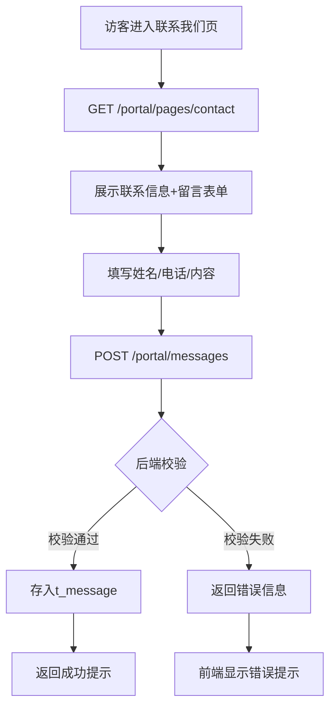
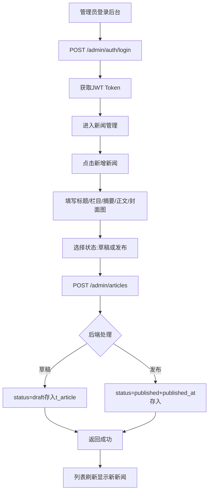
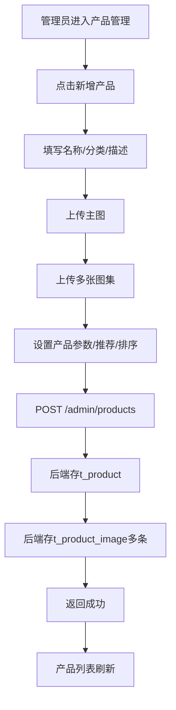
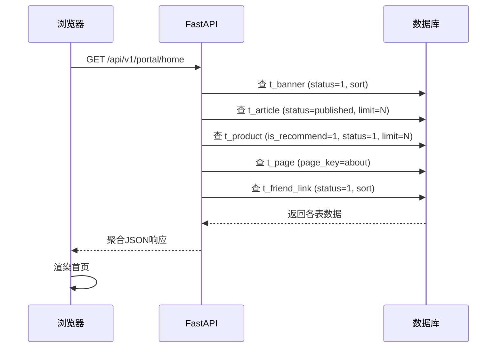
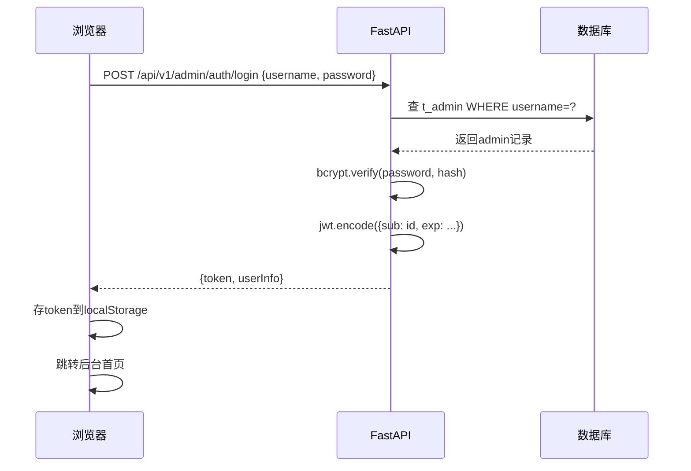
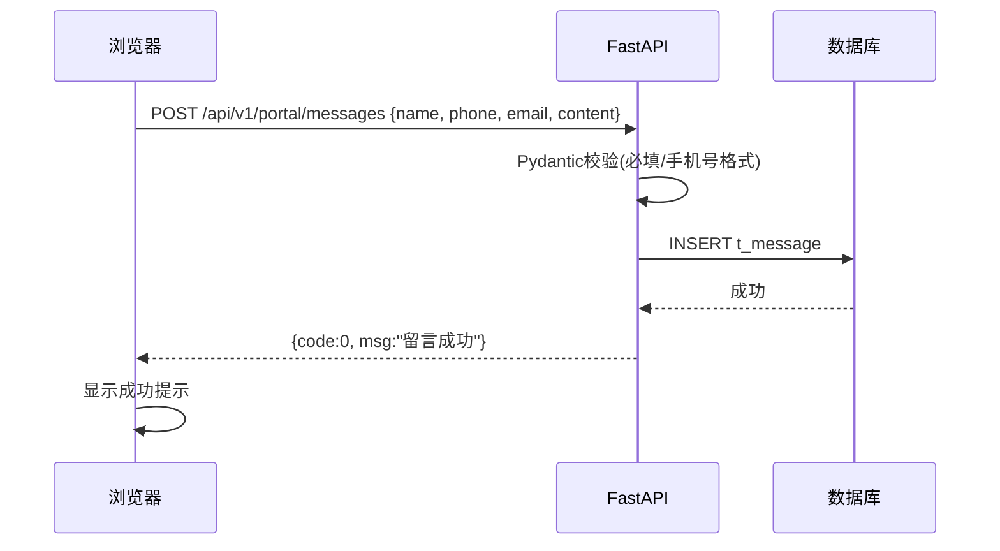

# 中小企业门户网站架构设计文档

> 创建时间：2026-09-30
> 状态：待确认
> 关联流程：fullstack-dev-flow stage-2
> 关联需求：docs/需求规格.md

---

## 一、技术栈选型

| 端 | 技术栈 | 版本 | 说明 |
|----|--------|------|------|
| 后端 | FastAPI | 0.110+ | 主力API服务，自带OpenAPI文档 |
| 前端 | Vue3 + Vite + TypeScript | 3.4+ | 前台门户 + 后台管理 |
| UI库 | Element Plus | 最新 | 后台管理UI组件 |
| 数据库 | SQLite / MySQL | - | 默认SQLite零配置，可切换MySQL |
| ORM | SQLAlchemy 2.0+ | 2.0+ | 数据库操作 |
| 包管理 | uv / npm | - | 后端uv，前端npm |
| 部署 | Nginx + Uvicorn | - | 反向代理+ASGI服务 |

### 关键决策

**决策1：FastAPI 不选 Django**
- 项目以API为主，FastAPI更轻量
- 自带Swagger文档，节省接口文档维护成本
- 性能优于Django，异步支持原生

**决策2：默认SQLite，可切换MySQL**
- SQLite零配置，降低部署门槛（中小企业场景）
- SQLAlchemy ORM抽象层，切换MySQL只需改连接串
- 初期单机部署足够，后续可平滑迁移

**决策3：前后端分离，共用一个前端项目**
- 前台门户（/）和后台管理（/admin）共用Vue3项目
- 通过路由区分，门户用门户布局，后台用后台布局
- 减少项目数量，统一构建部署

---

## 二、分层架构

### 2.1 后端分层

```
┌──────────────────────────────┐
│  Router (HTTP 接口)           │  <- 接收请求、参数校验(Pydantic)
├──────────────────────────────┤
│  Service (业务逻辑)           │  <- 实现业务规则、事务管理
├──────────────────────────────┤
│  Repository (数据操作)         │  <- 数据库CRUD，不含业务逻辑
├──────────────────────────────┤
│  Model (数据模型)             │  <- SQLAlchemy模型，对应表结构
└──────────────────────────────┘
```

### 2.2 前端分层

```
┌──────────────────────────────┐
│  views (页面级组件)           │  <- 路由对应页面
├──────────────────────────────┤
│  components (业务/通用组件)     │  <- 跨页面复用
├──────────────────────────────┤
│  api (接口调用封装)           │  <- 按模块分文件
├──────────────────────────────┤
│  utils (工具函数)             │  <- axios封装、token管理等
└──────────────────────────────┘
```

---

## 三、模块划分

| 模块 | 职责 | 涉及端 | 对应核心实体 |
|------|------|--------|------------|
| auth | 管理员登录/鉴权/改密 | 管理端 | 管理员 |
| dashboard | 仪表盘数据聚合 | 管理端 | 管理员 |
| article | 新闻文章CRUD+前台查询 | 访客端+管理端 | 新闻文章 |
| category | 栏目分类CRUD+前台查询 | 访客端+管理端 | 栏目分类 |
| product | 产品CRUD+前台查询+图集 | 访客端+管理端 | 产品展示 |
| page | 单页内容管理+前台查询 | 访客端+管理端 | 单页内容 |
| message | 留言提交+后台管理 | 访客端+管理端 | 留言咨询 |
| banner | 轮播图CRUD+前台查询 | 访客端+管理端 | 轮播图 |
| friend_link | 友情链接CRUD+前台查询 | 访客端+管理端 | 友情链接 |
| config | 网站配置管理 | 管理端 | 管理员(系统设置) |
| upload | 文件上传 | 管理端 | - |

> 铁律6检查：每个模块都对应至少1个核心实体 ✅

---

## 四、跨端通信图

```
[访客浏览器]  ──HTTP──┐
                      │
[管理后台浏览器] ──HTTP─┤
                      ├──> [Nginx] ──> [FastAPI 后端 :8000] ──> [SQLite/MySQL]
                      │                        │
                      │                        └──> [/uploads/ 静态文件]
                      │
[Vite Dev Server :5173] (开发期代理 /api → :8000)
```

### 开发期通信

```
前端(5173) ──proxy──> 后端(8000) ──> SQLite(app_db.db)
```

### 生产部署通信

```
浏览器 ──HTTP──> Nginx:80 ──┬──> 静态文件(frontend/dist)
                            └──> FastAPI:8000 ──> 数据库
```

---

## 五、目录结构

```
zxqy-web/
├── backend/                    # 后端代码
│   ├── app/
│   │   ├── __init__.py
│   │   ├── main.py             # FastAPI 入口
│   │   ├── core/
│   │   │   ├── config.py       # 配置(环境变量)
│   │   │   ├── database.py      # 数据库连接
│   │   │   └── security.py     # JWT/密码哈希
│   │   ├── models/             # SQLAlchemy 模型
│   │   │   ├── admin.py
│   │   │   ├── article.py
│   │   │   ├── product.py
│   │   │   ├── category.py
│   │   │   ├── page.py
│   │   │   ├── message.py
│   │   │   ├── banner.py
│   │   │   ├── friend_link.py
│   │   │   └── site_config.py
│   │   ├── schemas/            # Pydantic 数据结构
│   │   ├── repositories/       # 数据库操作
│   │   ├── services/            # 业务逻辑
│   │   ├── api/v1/              # 路由
│   │   │   ├── portal/          # 访客端接口
│   │   │   │   ├── home.py
│   │   │   │   ├── article.py
│   │   │   │   ├── product.py
│   │   │   │   ├── page.py
│   │   │   │   └── message.py
│   │   │   └── admin/          # 管理端接口
│   │   │       ├── auth.py
│   │   │       ├── dashboard.py
│   │   │       ├── article.py
│   │   │       ├── product.py
│   │   │       ├── category.py
│   │   │       ├── page.py
│   │   │       ├── message.py
│   │   │       ├── banner.py
│   │   │       ├── friend_link.py
│   │   │       ├── config.py
│   │   │       └── upload.py
│   │   └── utils/
│   ├── uploads/                # 上传文件存储
│   ├── sql/
│   ├── pyproject.toml
│   ├── seed.py                 # 初始化数据
│   └── .env.example
├── frontend/                   # 前端代码
│   ├── src/
│   │   ├── api/                # 接口调用封装
│   │   ├── assets/             # 静态资源
│   │   ├── components/         # 通用/业务组件
│   │   ├── layouts/            # 布局组件(PortalLayout/AdminLayout)
│   │   ├── router/             # 路由配置
│   │   ├── stores/             # Pinia状态管理
│   │   ├── utils/              # 工具函数
│   │   ├── views/
│   │   │   ├── portal/         # 前台门户页面
│   │   │   │   ├── Home.vue
│   │   │   │   ├── ArticleList.vue
│   │   │   │   ├── ArticleDetail.vue
│   │   │   │   ├── ProductList.vue
│   │   │   │   ├── ProductDetail.vue
│   │   │   │   ├── About.vue
│   │   │   │   ├── Culture.vue
│   │   │   │   ├── Contact.vue
│   │   │   │   └── NotFound.vue
│   │   │   └── admin/          # 后台管理页面
│   │   │       ├── Login.vue
│   │   │       ├── Dashboard.vue
│   │   │       ├── article/
│   │   │       ├── product/
│   │   │       ├── category/
│   │   │       ├── page/
│   │   │       ├── message/
│   │   │       ├── banner/
│   │   │       ├── friend_link/
│   │   │       └── config/
│   │   ├── App.vue
│   │   └── main.ts
│   ├── public/
│   ├── vite.config.ts
│   └── package.json
├── sql/
├── docs/
└── .devflow/
```

---

## 六、业务流程图

### 6.1 访客浏览新闻全流程

```mermaid
flowchart TD
    A[访客打开网站首页] --> B[GET /portal/home]
    B --> C[后端聚合轮播图+最新新闻+推荐产品]
    C --> D[首页渲染展示]
    D --> E{访客点击新闻}
    E --> F[GET /portal/articles?categoryId=xxx]
    F --> G[后端按栏目分页查询已发布新闻]
    G --> H[新闻列表页渲染]
    H --> I{访客点击某条新闻}
    I --> J[GET /portal/articles/{id}]
    J --> K[后端查新闻详情+上一篇/下一篇]
    K --> L[新闻详情页渲染]
```

### 6.2 访客提交留言流程



### 6.3 管理员发布新闻流程



### 6.4 管理员管理产品图集流程



---

## 七、时序图

### 7.1 前台首页加载时序



### 7.2 管理员登录时序



### 7.3 留言提交时序



---

## 八、已知约束

- Windows 环境开发，需注意中文路径对 npm/pip 的影响（项目目录使用英文路径）
- SQLite 并发写入限制（单管理员场景足够，多人同时管理需切换MySQL）
- 图片上传大小限制：单文件 ≤ 5MB，类型限制 jpg/png/gif/webp
- 富文本编辑器需做 XSS 过滤（后端存储前清洗 HTML）

---

## 九、变更记录

| 日期 | 变更内容 | 变更人 |
|------|---------|--------|
| 2026-09-30 | 初始创建 | AI+用户 |

> AI生成
